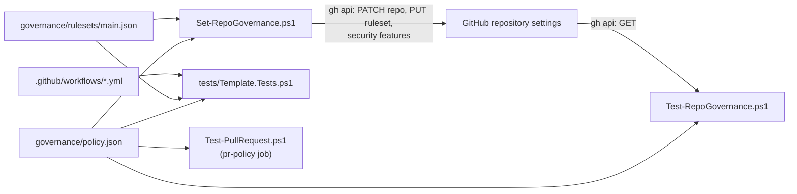
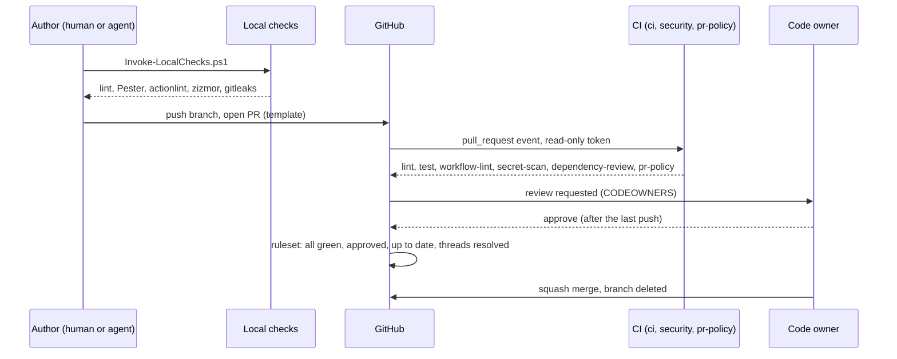

# DESIGN

How the template is put together, and why. The short version of each choice is in [docs/DECISIONS.md](docs/DECISIONS.md).

## Governance as files

Everything that decides whether a change may merge is a file in this repo:

| What | File | Applied by |
|---|---|---|
| The rules in one place | [governance/policy.json](governance/policy.json) | read by every script and by `tests/Template.Tests.ps1` |
| Branch protection | [governance/rulesets/main.json](governance/rulesets/main.json) | `Set-RepoGovernance.ps1` (GitHub REST: repository rulesets) |
| Repo settings and security features | `repoSettings` and `securityFeatures` in the policy | `Set-RepoGovernance.ps1` |
| Who must review what | [.github/CODEOWNERS](.github/CODEOWNERS) | GitHub, because the ruleset requires code owner review |
| What a PR must contain | `pullRequest` in the policy, [.github/pull_request_template.md](.github/pull_request_template.md) | `pr-policy` job via `Test-PullRequest.ps1` |
| What CI checks | [.github/workflows/](.github/workflows/) | GitHub Actions |
| What an AI agent may do | [.claude/settings.json](.claude/settings.json), [.claude/hooks/](.claude/hooks/), [CLAUDE.md](CLAUDE.md), [AGENTS.md](AGENTS.md) | Claude Code (and other agents through AGENTS.md) |

The files are checked against each other on every PR. `tests/Template.Tests.ps1` fails when a required check in the policy has no matching job, when the ruleset and the policy list different checks, or when a required file is missing. So a rule cannot be half-changed.

## The life of a change

An agent stops at "open PR". It never approves or merges: the settings deny `gh pr merge`, the guard hook denies it, and the ruleset requires an approval from someone other than the last pusher.

## Plans and visibility

GitHub turns some controls on only for some plans. The scripts never pretend:

| Control | Public repo (any plan) | Private repo, Free | Private repo, Pro/Team | Private repo, Advanced Security |
|---|---|---|---|---|
| Ruleset enforced | yes | **no** (Warn) | yes | yes |
| Secret scanning and push protection | yes | **no** (Warn) | **no** (Warn) | yes |
| Dependency review job | runs | skipped | skipped | runs if you change the job's `if:` |
| Dependabot alerts and updates | yes | yes | yes | yes |
| gitleaks in CI | yes | yes | yes | yes |
| Private vulnerability reporting | yes | **no** (Warn) | **no** (Warn) | **no** (Warn) |

For a private repo on Free, the effective controls are CI, CODEOWNERS as a convention, the agent guardrails and review discipline. Make the repo public, or move it to a paid plan, to have GitHub enforce the rest.

## CI design

- **Three workflows, six jobs.** The job ids are the required check names, so renaming a workflow never breaks the ruleset.
- **Pinned everything.** Actions by commit SHA, tools by version plus SHA-256, Pester and PSScriptAnalyzer by exact version. Dependabot proposes updates weekly with a 7-day cooldown.
- **Least privilege.** `contents: read` at the top of every workflow, no job asks for more, checkouts drop the token.
- **Untrusted input.** PR titles and bodies reach scripts only through environment variables; the scripts treat them as data.
- **Fail with a reason.** Each job writes a summary table to the run page and an `::error::` line naming what failed.

## Agent guardrails in layers

Described in full in [docs/AGENT_WORKFLOW.md](docs/AGENT_WORKFLOW.md). The design idea: each layer is cheap and imperfect, and they fail differently.

| Layer | Stops | Misses |
|---|---|---|
| Settings deny and ask rules | Obvious destructive or outward commands; reading secret files | Different spellings of the same command |
| Guard hook | Force pushes, pushes to `main`, `--no-verify`, secret-looking content, edits to governance paths without a human | Anything it was not written to recognise; it fails open |
| CI | Lint, test, policy and secret failures, whoever wrote the code | Nothing that is not tested |
| Ruleset and CODEOWNERS | Merging without review and green checks | Settings an admin changes (see RUNBOOK: governance drift) |

## Using it beyond one repo

- **New repo:** `New-GovernedRepo.ps1 -Name owner/name` creates it from the template and applies the policy.
- **Existing repo:** copy the files you need, then run `Set-RepoGovernance.ps1 -WhatIf` and `Test-RepoGovernance.ps1`.
- **Many repos:** the ruleset JSON works unchanged as an organization ruleset (Settings, Rules, Rulesets, Import), which repo admins cannot edit. A scheduled job can run `Test-RepoGovernance.ps1` for each repo and open an issue on drift. Both are follow-ups, not part of this template.
