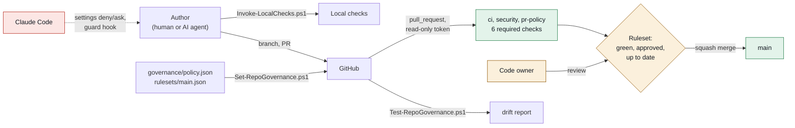

# governed-repo-template

[](https://github.com/kaushik-sai/governed-repo-template/actions/workflows/ci.yml)
[](https://github.com/kaushik-sai/governed-repo-template/actions/workflows/security.yml)

A GitHub template repository. A project made from it starts **governed** (branch rules, code owners and PR rules as code), **secure** (secret scanning, a pinned supply chain, least-privilege CI) and **agent-ready** (Claude Code settings, a guard hook, CLAUDE.md, AGENTS.md and a written agent workflow). Scripts apply the GitHub-side settings to a repo and audit them later, so the rules in Git and the rules on GitHub stay the same.

## What this shows

| Practice | How | Where |
|---|---|---|
| Governance as code | One policy file; a ruleset JSON; scripts that apply and audit both. A test fails when the policy, ruleset and workflows disagree | [governance/](governance/), [scripts/](scripts/), [tests/Template.Tests.ps1](tests/Template.Tests.ps1) |
| Branch protection | PR required, code owner review, approval after the last push, six required checks from GitHub Actions only, squash only, no force push or deletion | [governance/rulesets/main.json](governance/rulesets/main.json) |
| Secure CI | Read-only token, actions pinned by SHA, tools checked against SHA-256, no `pull_request_target`, untrusted PR text only through `env:`, zizmor and actionlint on every PR | [.github/workflows/](.github/workflows/) |
| Secret hygiene | gitleaks over the full history on PRs, `main` and weekly; push protection where the plan allows; a runbook for leaks | [.github/workflows/security.yml](.github/workflows/security.yml), [RUNBOOK.md](RUNBOOK.md) |
| AI agent guardrails | Deny and ask rules, a PreToolUse guard hook with tests, protected paths that always need a human, the orchestrate working method | [.claude/](.claude/), [CLAUDE.md](CLAUDE.md), [AGENTS.md](AGENTS.md), [docs/AGENT_WORKFLOW.md](docs/AGENT_WORKFLOW.md) |
| Readable history | Conventional Commit titles and five required PR sections, checked in CI; squash merges take the PR title and body | [scripts/Test-PullRequest.ps1](scripts/Test-PullRequest.ps1), [.github/pull_request_template.md](.github/pull_request_template.md) |
| Testable PowerShell | Every `gh` and `git` call goes through one wrapper that Pester mocks, so tests need no network or token | [scripts/lib/Cli.ps1](scripts/lib/Cli.ps1), [tests/](tests/) |
| Written decisions and operations | Numbered decisions, a design, a threat model, runbooks | [DESIGN.md](DESIGN.md), [docs/DECISIONS.md](docs/DECISIONS.md), [docs/THREAT_MODEL.md](docs/THREAT_MODEL.md), [RUNBOOK.md](RUNBOOK.md) |

## How it fits together



Green is what passes automatically, amber needs a human, red is where the agent is held back.

## Start a new repo from this template

Prerequisites: PowerShell 7.4+ (built with 7.6.7), [GitHub CLI](https://cli.github.com/) logged in (`gh auth login`) with admin rights on the target repo, and git.

```powershell
# Preview: shows every gh call, changes nothing.
pwsh ./scripts/New-GovernedRepo.ps1 -Name your-user/your-repo -WhatIf

# Create it (private by default) and apply the policy.
pwsh ./scripts/New-GovernedRepo.ps1 -Name your-user/your-repo -Visibility private -Description "What it does"
```

Or press **Use this template** on GitHub, then run `Set-RepoGovernance.ps1` on the new repo.

After creating it:
1. Replace `@kaushik-sai` in [.github/CODEOWNERS](.github/CODEOWNERS) with your user or team.
2. Update the security contact in [SECURITY.md](SECURITY.md) and the copyright in [LICENSE](LICENSE).
3. Run the audit (below). On a private repo on GitHub Free some rows are Warn; [DESIGN.md](DESIGN.md#plans-and-visibility) says why.

## Apply or audit governance on any repo

```powershell
# Audit the working tree only (no network): required files, ruleset vs policy, required checks vs workflow jobs.
pwsh ./scripts/Test-RepoGovernance.ps1 -Path .

# Also compare the live GitHub settings and ruleset with the policy. Exit code 1 means at least one Fail.
pwsh ./scripts/Test-RepoGovernance.ps1 -Path . -Repository your-user/your-repo

# Apply the policy: repo settings, Dependabot alerts and updates, secret scanning, private vulnerability
# reporting, and the ruleset (created, or updated by name). Safe to run twice.
pwsh ./scripts/Set-RepoGovernance.ps1 -Repository your-user/your-repo -WhatIf
pwsh ./scripts/Set-RepoGovernance.ps1 -Repository your-user/your-repo
```

| Script | Parameters | Exit code |
|---|---|---|
| `New-GovernedRepo.ps1` | `-Name owner/name` `[-Template kaushik-sai/governed-repo-template]` `[-Visibility private\|public\|internal]` `[-Description]` `[-WhatIf]` | 1 if the repo exists or a step fails |
| `Set-RepoGovernance.ps1` | `-Repository owner/name` `[-PolicyPath]` `[-WhatIf]` | 1 on a failure; features the plan refuses are warnings |
| `Test-RepoGovernance.ps1` | `[-Path .]` `[-Repository owner/name]` `[-PolicyPath]` | 1 if any check is Fail |
| `Test-PullRequest.ps1` | `-Title` `-Body` `[-ChangedFiles n]` `[-TitleOnly]` `[-PolicyPath]` | 1 if the PR breaks the policy |
| `Invoke-LocalChecks.ps1` | `[-Skip lint,test,actionlint,zizmor,gitleaks]` | 1 if any check failed |

## Lint and tests

```powershell
# Everything CI runs, in one command. A missing tool shows as Skip with how to install it.
pwsh ./scripts/Invoke-LocalChecks.ps1

# Or one at a time.
pwsh -NoProfile -Command "Invoke-ScriptAnalyzer -Path . -Recurse -Settings ./PSScriptAnalyzerSettings.psd1"
pwsh -NoProfile -Command "Invoke-Pester -Path ./tests -Output Detailed"
actionlint
zizmor --offline .github/workflows
gitleaks git . --redact --no-banner
```

| Tool | Version | Used for |
|---|---|---|
| PowerShell | 7.4+ (built and tested with 7.6.7) | scripts and tests |
| Pester | 5.9.1 | unit tests |
| PSScriptAnalyzer | 1.25.0 | lint (Error and Warning fail) |
| actionlint | 1.7.12 | workflow syntax |
| zizmor | 1.31.1 | workflow security |
| gitleaks | 8.30.1 | secret scanning |
| GitHub CLI | any 2.x | the governance scripts (not needed for tests) |

## CI

| Workflow | Job (required check) | What it does |
|---|---|---|
| [ci.yml](.github/workflows/ci.yml) | `lint` | PSScriptAnalyzer over every PowerShell file |
| | `test` | Pester, including the policy-as-code tests; NUnit results as an artifact |
| | `workflow-lint` | actionlint and zizmor over `.github/workflows` |
| [security.yml](.github/workflows/security.yml) | `secret-scan` | gitleaks over the full history; also on `main` and weekly |
| | `dependency-review` | blocks PRs that add vulnerable dependencies (public repos; see DESIGN) |
| [pr-policy.yml](.github/workflows/pr-policy.yml) | `pr-policy` | Conventional Commit title, required PR sections, size warning |

## Working with AI agents

Claude Code reads [CLAUDE.md](CLAUDE.md) and [.claude/settings.json](.claude/settings.json); other agents read [AGENTS.md](AGENTS.md). The agent works on a branch, runs the local checks, opens a PR with the AI assistance section filled in, and stops. A human reviews and merges. The full workflow, the guardrail layers and what each one misses are in [docs/AGENT_WORKFLOW.md](docs/AGENT_WORKFLOW.md).

## Verification status

See [docs/EVIDENCE.md](docs/EVIDENCE.md) for real runs with numbers, and what is not verified yet.

## License

[MIT](LICENSE)
