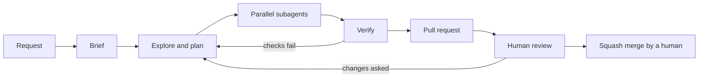
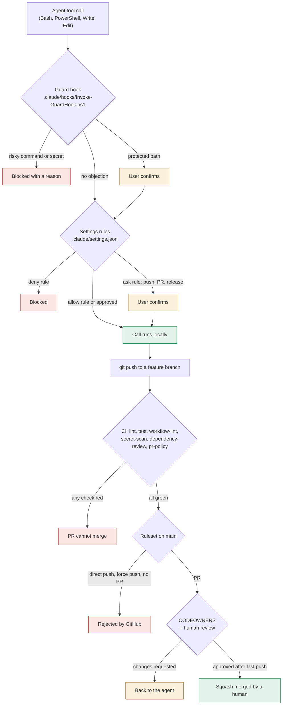

# Agent workflow

How an AI agent takes a request from the first message to a merged PR in a repo made from this template, and the guardrails around each step. Claude Code reads [CLAUDE.md](../CLAUDE.md); other agents read [AGENTS.md](../AGENTS.md).

## End to end

1. **Request.** An issue (the agent-task form needs testable requirements and acceptance criteria) or a message to the agent.
2. **Brief.** The agent rewrites the request with [the brief template](../.claude/skills/orchestrate/references/brief-template.md): goal, context, testable requirements, out of scope, deliverables, acceptance criteria, assumptions. It shows the brief in 10 to 15 lines and asks only what would change the outcome.
3. **Explore, then plan.** Read the files, tests and docs involved. Split the work into tasks by file ownership: two tasks that write the same file cannot run in parallel.
4. **Parallel subagents.** Independent tasks start in one message, each with a [subagent brief](../.claude/skills/orchestrate/references/subagent-brief.md): the facts, the files it owns, the files it must not touch, bounded verify commands, a short report. Every subagent gets an explicit model and effort:

   | Work | Model | Effort |
   |---|---|---|
   | Find files, grep, list, read-only lookups, versions | haiku | low |
   | Mechanical edits from exact instructions | sonnet | low |
   | Well-specified implementation: tests from a spec, CI from a reference, docs from an outline | sonnet | medium |
   | Multi-file feature that needs judgment, unclear bug, code or security review | opus | high |
   | Architecture trade-offs, subtle correctness bugs, high-stakes migrations | opus | xhigh, rarely |

   Never `max` unless the user asks. Go up one level only after a failure caused by reasoning, not by a vague brief.
5. **Verify.** The main agent reads every changed file (a subagent's report is a claim, not a fact) and runs `pwsh ./scripts/Invoke-LocalChecks.ps1` once on the combined result, plus the script or app itself. What can only be checked later (a CI run, a GitHub-side apply) is written down as not verified.
6. **Pull request.** Feature branch, Conventional Commit title, every template section filled. `## How it was verified` has commands and numbers. `## AI assistance` says what the agent wrote and what a human must check. Pushing and opening the PR need the user's confirmation (settings `ask` rules).
7. **Human review.** A code owner reviews. The ruleset needs one approval after the last push, resolved threads and six green checks.
8. **Merge.** A human squash-merges. Agents never merge (`gh pr merge` is denied).

The method is the orchestrate skill in [.claude/skills/orchestrate/](../.claude/skills/orchestrate/SKILL.md). It ships with the template, so every repo made from it works the same way.

## Guardrail layers

Each layer catches what the one before it missed. Green passes the call on, amber needs a human, red stops it.

Claude Code runs PreToolUse hooks before it checks the permission rules. A hook `deny` (or exit code 2) blocks the call even when an allow rule matches. A hook cannot override a deny or ask rule: those are checked whatever the hook returns. So the two local layers add up; neither can weaken the other.

### What each layer does

| Layer | Where | What it does |
|---|---|---|
| Settings deny and ask | [.claude/settings.json](../.claude/settings.json) | Deny: reading `.env`, `.env.*` (`.env.example` too: keep examples in docs), `*.pem`, `*.key`, `*.pfx`, `secrets/`; force pushes, `git reset --hard`, `rm -rf` of `/` or home, a bare `sh`/`bash` (the receiving end of `curl ... \| sh`), `gh repo delete`, `gh api` DELETE, `gh pr merge`. Ask: `git push`, `gh pr create`, `gh release`, edits to workflows, `governance/`, `.claude/settings*.json`, `.claude/hooks/`, CODEOWNERS. Allow without a prompt: `git status`/`diff`/`log`, `Invoke-LocalChecks.ps1`, the exact Pester and analyzer commands. |
| Guard hook | [.claude/hooks/Invoke-GuardHook.ps1](../.claude/hooks/Invoke-GuardHook.ps1) | Reads every Bash, PowerShell, Write, Edit and MultiEdit call. Denies force pushes in any spelling, pushes to `main`/`master`, `--mirror`/`--all`, history rewrites (`filter-branch`, `filter-repo`, `reset --hard`, moving `main`), `--no-verify`, `commit -n`, `core.hooksPath`, disabling or deleting workflows and rulesets, reading secret files, pipe-to-shell, and writing content that looks like a secret (the reason names the kind, never the value). Asks for `--force-with-lease` on a feature branch, any write to a protected path, and the scripts that change GitHub settings. Looks inside `bash -c`, `pwsh -Command`, `$( )` and compound commands. Tests: [tests/GuardHook.Tests.ps1](../tests/GuardHook.Tests.ps1). |
| CI | `.github/workflows/` | The same checks as `Invoke-LocalChecks.ps1`, plus dependency review and the PR title and body policy. Runs on GitHub, so the agent cannot skip it. |
| Ruleset | [governance/rulesets/main.json](../governance/rulesets/main.json) | On `main`: no deletion, no force push, linear history, PR required, six required checks, squash only. Enforced by GitHub. |
| CODEOWNERS | `.github/CODEOWNERS` | A change to `.github/`, `governance/`, `.claude/`, `CLAUDE.md`, `AGENTS.md` or `SECURITY.md` needs the owner's review. |
| Human review | the PR | One approval after the last push, threads resolved. A human merges. |

### What each layer does NOT catch

| Layer | Gaps |
|---|---|
| Settings rules | They match command text. `git -C . push --force`, `/usr/bin/git push -f`, `sh -c '...'` and a variable holding the command all get past a `Bash(...)` rule. `Read` deny rules do not stop a script that opens the file itself (`python app.py` reading `.env`). Other agents (Copilot, Codex, Cursor) never load this file. |
| Guard hook | Also text matching, only smarter. It cannot see what a script, a Makefile target, an alias or a downloaded program does when it runs. It does not know the current branch, so a bare `git push` or `git commit --amend` on `main` passes it (the settings `ask` rule and the ruleset still apply). `grep -r TOKEN .` reads `.env` without naming it. Secret patterns catch common formats, not every secret. It does not see the Read tool (the settings deny rules cover that). **It fails open**: if pwsh is missing or the input cannot be parsed, it exits 1, the user sees a "hook error" notice, and the call goes on to the normal permission rules. A fail-closed hook would stop every tool call the moment it broke; CI, the ruleset and review still apply, so a broken hook loses one layer, not all. To fail closed instead, add `"onFailure": "block"` to the hook entries (Claude Code v2.1.295 or later). |
| CI | Only runs on what is pushed. It does not see local actions: a secret read and pasted into a chat, a file deleted outside git, a call to an external API. A test that asserts the wrong thing still passes. |
| Ruleset | Protects `main` only. Feature branches can be force-pushed. Repository admins can bypass it through a PR. Changes to the GitHub-side ruleset are applied by `Set-RepoGovernance.ps1`, which a human runs. |
| CODEOWNERS | Needs a real owner. In a repo made from the template, replace `@kaushik-sai` with your user or team, or the review goes to the wrong person. A solo owner reviewing their own agent's PR is one person, not two. |
| Human review | People skim large diffs. Keep PRs small (the policy warns above 60 files) and read the `## AI assistance` section. |

No single layer is a security boundary. For hard isolation of files and network, run the agent in Claude Code's sandbox or a container.

## Settings facts this relies on

Taken from the Claude Code docs (hooks, settings, permissions), October 2026:

- A PreToolUse hook gets JSON on stdin with `tool_name` and `tool_input` (`command` for Bash and PowerShell; `file_path` plus `content` for Write, `new_string` for Edit).
- It answers with exit 0 and `{"hookSpecificOutput":{"hookEventName":"PreToolUse","permissionDecision":"deny"|"ask","permissionDecisionReason":"..."}}`. No output means no opinion. Exit 2 also blocks. Any other exit code is a non-blocking error.
- The hook runs in exec form (`"command": "pwsh"` with `"args"`), so `${CLAUDE_PROJECT_DIR}` is substituted as one argument with no shell quoting. That works the same in PowerShell, Git Bash and Linux, and with spaces in the path.
- Rules use `Tool(specifier)`; `Bash(git push *)` also matches the bare `git push`. `Read`/`Edit` paths use gitignore syntax: `/path` is relative to the project root, a bare name matches at any depth, and a `!` rule carves an exception out of the deny rules before it.

## Verified and not verified

- Verified: the hook's decisions by table-driven Pester tests, including near misses that must pass, and by running the script as a process with JSON on stdin. `.claude/settings.json` parses as JSON.
- Not verified: the hook and the rules inside a live Claude Code session (no session was run when this was written). Whether a `PowerShell(...)` rule prints a startup warning on a machine where the PowerShell tool is not enabled.
